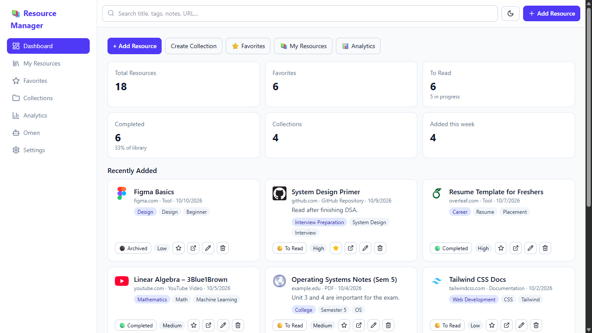
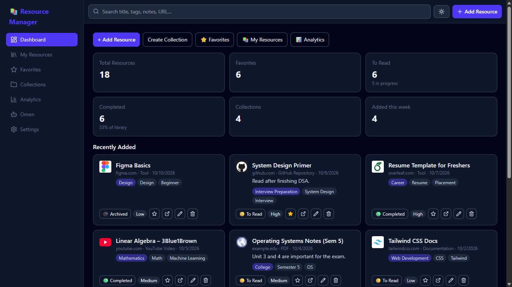
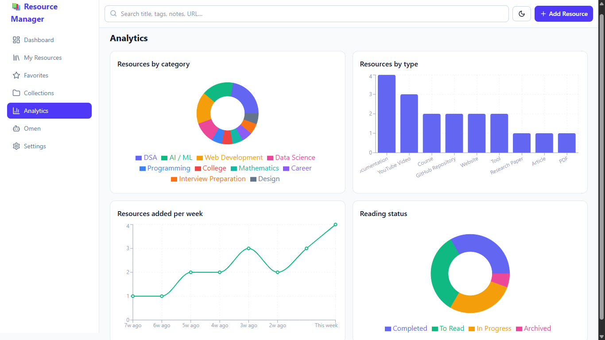
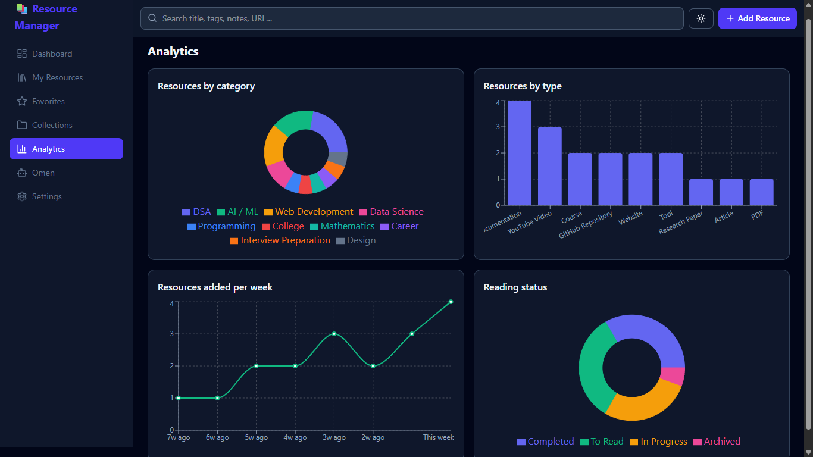

# Bookmark & Resource Manager

## Overview
Students and developers save hundreds of links and then can't find them. This app is a personal knowledge library: save resources, organize them with categories, tags and collections, track what you've read, and see your progress. It runs fully in the browser with no backend.

## Features
- Add / edit / delete resources with validation and duplicate-URL detection
- Auto-detected domain, favicon, title and type from the URL
- **Smart Categorize** (local keyword engine) suggests category, type and tags
- Search (title, URL, description, category, tags, notes, type), filters, 7 sort options
- Grid and list views, details popup, personal notes
- Favorites page, status tracking (To Read → In Progress → Completed), Archived
- Collections with per-collection progress stats
- Dashboard: stats, recently added, recently viewed, "You May Also Like"
- Analytics: category donut, type bar, weekly line, status donut
- JSON/CSV export, JSON import, light/dark mode, responsive (bottom nav on mobile)

## Screenshots

### Main Dashboard

<table>
  <tr>
    <th>Light Mode</th>
    <th>Dark Mode</th>
  </tr>
  <tr>
    <td></td>
    <td></td>
  </tr>
</table>

### Analytics Dashboard

<table>
  <tr>
    <th>Light Mode</th>
    <th>Dark Mode</th>
  </tr>
  <tr>
    <td></td>
    <td></td>
  </tr>
</table>

## Tech Stack
React 18, Vite, React Router (HashRouter), Tailwind CSS v4, Recharts, Lucide React, localStorage.

## Installation
NodeJS : https://nodejs.org/en/download
Requires Node.js 18+.
```bash
npm install
OR
double-click on "install.bat"
```

## Running Locally
```bash
double-click on "run.bat"  # then open the printed http://localhost:5173
npm run dev                # then open the printed http://localhost:5173
npm run build              # production build in /dist
```

## Project Structure
```
src/
├── components/  Layout, ResourceCard, ResourceList, ResourceForm, Modal, ConfirmDialog, EmptyState, StatsCard, TagBadge, ResourceChart
├── pages/       Dashboard, Resources (also Favorites), Collections, Analytics, SettingsPage
├── hooks/       useLibrary.jsx – all state + actions (React Context)
├── services/    metadataService.js, smartCategorize.js – swap for real APIs later
├── utils/       constants, resource (data shape), storage (localStorage), stats (math)
└── data/        sampleData.js
```

## How It Works
`LibraryProvider` (in `useLibrary.jsx`) holds `resources` and `collections`. Pages read them with `useLibrary()` and call actions like `saveResource`. Every change updates state, which re-renders the UI and charts and is auto-saved to localStorage.

## Smart Categorization
`services/smartCategorize.js` scores each category by how many of its keywords appear in the title, URL, description and notes, picks the best, detects the type from the URL/words, and suggests tags. The function is `async` so it can be replaced by an LLM API call without changing the form.

## Data Storage
`utils/storage.js` is the only file that touches localStorage (key `rm_data_v1`). Corrupted data falls back to demo data. Replace it with API calls to move to a database.

## Future Improvements
Backend API + auth (Supabase / Express + PostgreSQL), real page-title fetching on the server, CSV import, browser extension, tests, tag management page.

## AI Features Planned
Summarizer, AI tag generator, semantic duplicate detection, recommendation engine, study roadmap, natural-language search.

## Contributing
Fork, create a feature branch, commit with clear messages, open a pull request.

## License
MIT – see `LICENSE`.
